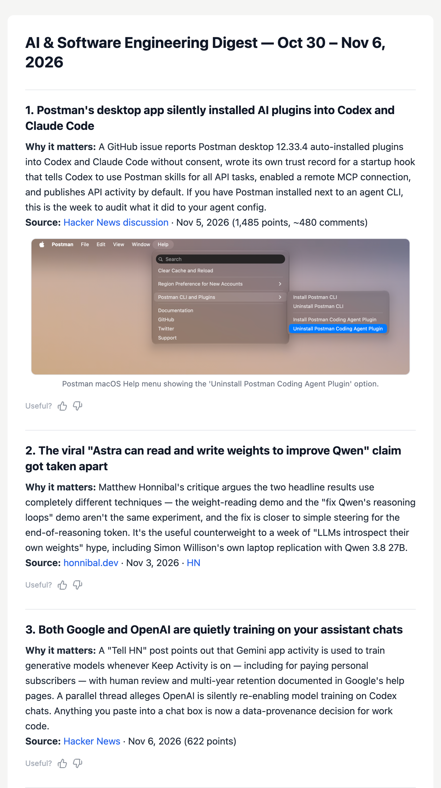
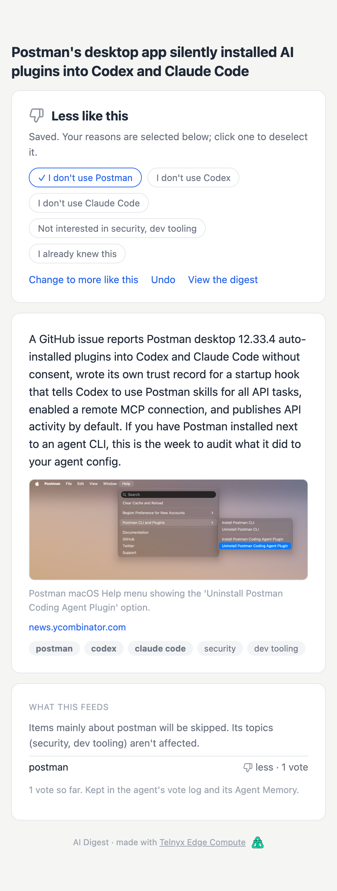
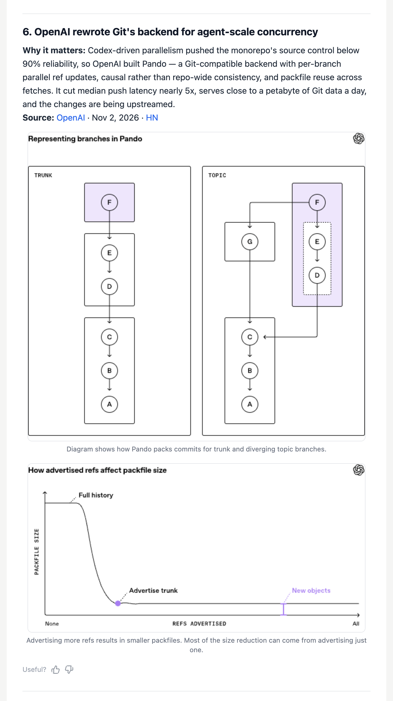
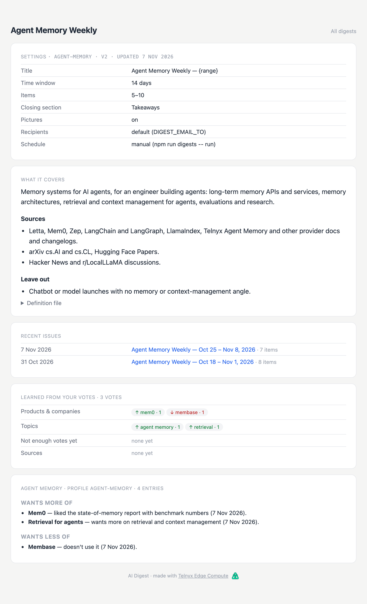
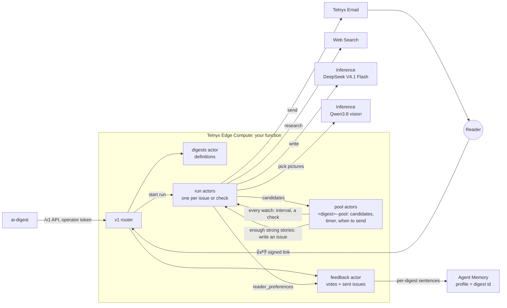

# AI Digest

Email digests on any topic, researched and written by an AI agent on [Telnyx Edge Compute](https://developers.telnyx.com/docs/edge-compute/platform-overview). You describe each digest in a short Markdown file: what to cover, for whom, where to look, how far back, how many items. The agent researches it, writes it, illustrates it with the articles' own diagrams and charts, emails it, and learns what you care about from one-tap feedback, separately for each digest.

It runs entirely on Telnyx: Edge Compute for hosting and durable state, Telnyx Inference for the models, Web Search for research, Email for delivery and [Agent Memory](https://developers.telnyx.com/docs/agent-memory) for preferences.

<p align="center">
  
  &nbsp;
  
</p>

## What it does

- **Digests you define.** One file per digest, e.g. `digests/agent-memory.md`, with its title, topic and audience, sources, time window, length and closing section. Your digests stay private: the folder is git-ignored and stored on your own function.
- **Watches its topic** when a digest has `watch: 6h`: short checks keep a pool of candidate stories, and an issue goes out when enough strong ones have gathered, or after `max_gap` at the latest. Stories that several sources cover, or that keep coming back, rank higher; an issue lists up to 3 sources per story and at most 2 stories about the same product.
- **One-off digests on any topic**, on demand: `ai-digest ask "agent harnesses"`. A built-in General digest fills its template with your topic; no file needed.
- **Researches** each issue with about 25 web searches and page reads (a watching digest spreads that over its checks and writes the issue from its pool), using only items from the requested window and linking to the specific articles.
- **Illustrates** items with pictures from the source articles, only when a vision model judges them informative for that digest's reader: charts, diagrams, product screenshots.
- **Emails** every finished digest from your own domain, to the digest's recipients. Sending is done by code, not left to the model.
- **Shows your digests on a page** at `/v1/app` on your function, behind a magic-link sign-in: each digest's settings and description, its recent issues, what it learned from your votes, and its Agent Memory summary.
- **Learns per digest** from grey 👍/👎 links under each item. After a click you can say why, picking any number of reasons ("I don't use Postman", "not interested in this topic", "already knew it"). Each digest keeps its own vote log and Agent Memory profile, named after the digest. Only explicit product reasons cross between digests: one-off digests know what you don't use or want more of from your other digests, and your regular digests learn the products you said you don't use in one-offs.

<p align="center">
  
</p>

<p align="center">
  
</p>

## A digest definition

```markdown
---
title: "Agent Memory — {range}"
window: 14d
items: 5-10
closing: Takeaways
watch: 12h          # optional: check for news every 12 hours, send when enough is worth reading
---
Memory systems for AI agents, for an engineer building agents: long-term memory
APIs and services, memory architectures, retrieval and context management.

## Sources
- Memory frameworks and services, established and new (e.g. Letta, Mem0, Zep,
  Hindsight, Telnyx Agent Memory); look for projects you haven't seen before too.
- New open-source projects (GitHub, Show HN); arXiv cs.AI and cs.CL.

## Leave out
- Chatbot launches with no memory angle.
```

Examples to copy: [`examples/digests/`](examples/digests). All settings are described in [docs/SETUP.md](docs/SETUP.md#5-define-your-digests), watching in [step 9](docs/SETUP.md#9-let-a-digest-watch-its-topic).

```sh
ai-digest push                    # upload digests/*.md to your function
ai-digest run agent-memory        # an issue now (3–5 minutes, then it's emailed)
ai-digest pool agent-memory       # a watching digest's pool: candidates, next check, why no issue yet
ai-digest watch agent-memory      # a check now (it only adds to the pool)
ai-digest ask "agent harnesses"   # a one-off digest on any topic
ai-digest list
```

Then open `https://<your function>/v1/app` and sign in with the link it emails you.

## How it works



The function has its own entry point and a versioned HTTP API (`/v1/…`). See [docs/HOW-IT-WORKS.md](docs/HOW-IT-WORKS.md) for the API, the research loop, watching digests and their pools, picture selection, signed feedback links, how votes become preferences, and what's stored where.

## Set it up on your Telnyx account

About 30 minutes, most of it waiting for DNS. The full guide with links is **[docs/SETUP.md](docs/SETUP.md)**. In short:

1. [Create a Telnyx account](https://telnyx.com/sign-up) and an [API key](https://developers.telnyx.com/development/api-fundamentals/create-api-keys); install the [Edge Compute CLI](https://developers.telnyx.com/docs/edge-compute/platform-overview) (`telnyx-edge`).
2. [Verify a sending domain](https://developers.telnyx.com/docs/messaging/email/domains) in Telnyx Email (ownership, DKIM and SPF records).
3. Clone, `npm install`, `npm link` (installs the `ai-digest` command), `cp .env.example .env` and set your sender and recipient.
4. Copy a digest from `examples/digests/` into `digests/` and edit it.
5. `ai-digest deploy`, then `ai-digest run <digest>`.

## Project layout

| Path | What it is |
|---|---|
| `src/index.ts`, `src/router.ts` | The function's entry point and its v1 HTTP API |
| `src/agent.ts` | The agent: research loop, deterministic email delivery, the `feedback`, `digests` and pool actors, the email template |
| `src/profile.ts` | Parsing digest definitions and turning one into a run's request |
| `src/instructions.ts` | How to research and write any digest |
| `src/pool.ts`, `src/watch-instructions.ts` | Watching: the candidate pool, scores, when to send; the check and issue-writing requests |
| `src/general.ts` | The built-in General digest's template (one-off topics) |
| `src/images.ts` | Picking pictures from the source articles |
| `src/feedback.ts`, `src/preferences.ts` | Signed thumbs links, the feedback pages, votes into preferences |
| `src/app.ts` | The digests page and its magic-link sign-in |
| `src/config.ts`, `src/auth.ts` | Settings from Telnyx secrets; the operator token |
| `examples/digests/` | Digest definitions to copy (your own go in the git-ignored `digests/`) |
| `docs/memory-summary-instructions.md` | How Agent Memory summarises a digest reader's interests |
| `docs/spec/` | Decision records and design specs, numbered |
| `bin/ai-digest.mjs` | The `ai-digest` command (`npm link`): one entry point for the scripts below, from any folder |
| `scripts/` | `deploy`, `digests`, `release`, `screenshots` |
| `test/` | Regression tests (`npm test`) |

## Development

```sh
npm install && npm link           # npm link: the ai-digest command, once
npm test                         # node:test, no network
ai-digest screenshots            # regenerate docs/images from scripts/fixtures (needs Chrome)
ai-digest deploy                 # tests, secrets, build, ship, push digests
ai-digest release minor          # bump version, date the changelog, commit and tag
```

Requires Node.js 23.6 or newer (it runs TypeScript directly) and the [`telnyx-edge`](https://developers.telnyx.com/docs/edge-compute/platform-overview) CLI.

## Versioning

[Semantic versioning](https://semver.org). The HTTP API is versioned in its path (`/v1`). Changes are listed in [CHANGELOG.md](CHANGELOG.md); add yours under *Unreleased*, and `ai-digest release` dates them.

## License

[GPL-3.0-or-later](LICENSE). You can use, change and share it; if you distribute a modified version, it must stay under the GPL.

## Notes

This is an independent project built on Telnyx's public APIs, not an official Telnyx product. Agent Memory is in beta, so its API may change.
