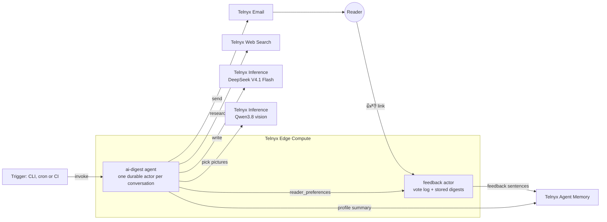

# AI Digest

An AI agent on [Telnyx Edge Compute](https://developers.telnyx.com/docs/edge-compute/platform-overview) that researches the week's AI and software engineering news, emails you a digest with the articles' own diagrams and charts, and learns what you care about from one-tap feedback.

It's built with the [Telnyx Agent Control Plane](https://developers.telnyx.com/docs/agents) CLI (`telnyx-acp`) and uses only Telnyx services: Edge Compute for hosting and durable state, Telnyx Inference for the models, Web Search for research, Email for delivery and Agent Memory for preferences.

<p align="center">
  
  &nbsp;
  
</p>

## What it does

- **Researches** the last 7 days across community sites, AI labs, newsletters and engineering blogs (about 25 searches and page reads), or any topic you ask for ("articles about agent frameworks").
- **Writes** 5–15 items, most important first, each with *why it matters* and links to the specific articles, then a short *Themes this week*.
- **Illustrates** items with pictures from the source articles, only when a vision model judges them informative: benchmark charts, architecture diagrams, product screenshots. Stock photos and banners are skipped.
- **Emails** the digest from your own domain, every time it writes one. Sending is done by code, not left to the model.
- **Learns** from grey 👍/👎 links under each item. After a click you can say why, picking any number of reasons: "I don't use Postman", "not interested in this topic", "already knew it". The next digest ranks with that in mind and still includes major news.

<p align="center">
  
</p>

## How it works



See [docs/HOW-IT-WORKS.md](docs/HOW-IT-WORKS.md) for the details: the research loop, picture selection, signed feedback links, how votes become preferences, and what's stored where.

## Set it up on your Telnyx account

About 30 minutes, most of it waiting for DNS. The full guide with links is in **[docs/SETUP.md](docs/SETUP.md)**. In short:

1. [Create a Telnyx account](https://telnyx.com/sign-up) and an [API key](https://developers.telnyx.com/development/api-fundamentals/create-api-keys).
2. `npm install -g @telnyx/acp && telnyx-acp login`
3. [Verify a sending domain](https://developers.telnyx.com/docs/messaging/email/domains) in Telnyx Email (ownership, DKIM and SPF records).
4. Clone this repo, `npm install`, `cp .env.example .env` and fill in your sender and recipient.
5. `npm run deploy`, then ask for a digest:
   ```sh
   npx telnyx-acp invoke ai-digest --conversation first-digest "Weekly digest: the most important AI and software engineering news from the past 7 days."
   ```

## Project layout

| Path | What it is |
|---|---|
| `agent.json` | The agent spec: model, tools, step limit, and the **names** of its secrets |
| `src/agent.ts` | The agent class: deterministic email delivery, the feedback endpoint, the email template |
| `src/instructions.ts` | What the research model is told |
| `src/images.ts` | Picking pictures from the source articles |
| `src/feedback.ts` | Signed thumbs links, the feedback pages, the vote log and memory writes |
| `src/preferences.ts` | Turning votes (and their reasons) into entity, topic and source preferences |
| `src/config.ts` | Settings read from Telnyx secrets |
| `docs/memory-summary-instructions.md` | How Agent Memory summarises your interests |
| `scripts/` | `deploy`, `release`, `screenshots` and the git filter |
| `test/` | Regression tests (`npm test`) |

## Development

```sh
npm install
npm test                         # node:test, no network
npm run screenshots              # regenerate docs/images from docs/fixtures (needs Chrome)
npm run deploy                   # tests, secrets from .env, deploy
npm run release -- minor         # bump version, date the changelog, commit and tag
```

After cloning, enable the git filter that keeps your deployment's function id and URL out of commits (`telnyx-acp deploy` writes them into `agent.json`):

```sh
git config filter.strip-deployed.clean "node scripts/strip-deployed.mjs"
git config filter.strip-deployed.smudge cat
```

Requires Node.js 23.6 or newer (it runs TypeScript directly).

## Versioning

[Semantic versioning](https://semver.org). Changes are listed in [CHANGELOG.md](CHANGELOG.md); add yours under *Unreleased*, and `npm run release` dates them.

## License

[GPL-3.0-or-later](LICENSE). You can use, change and share it; if you distribute a modified version, it must stay under the GPL.

## Notes

This is an independent project built on Telnyx's public APIs, not an official Telnyx product. Agent Memory and the Agent Control Plane are in beta, so APIs may change.
